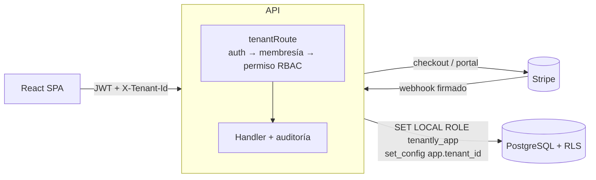

# ▲ Tenantly — SaaS multi-tenant con facturación

Plataforma SaaS B2B de referencia: **espacios de trabajo aislados**, **roles y permisos**, **planes con límites**, **suscripciones con Stripe**, **auditoría** y API lista para producción.

> El dominio (proyectos) es deliberadamente simple. Lo interesante es la infraestructura que todo SaaS real necesita y que casi nunca aparece en proyectos de portafolio.

| | |
|---|---|
| **Backend** | Node 22 · TypeScript estricto · Fastify 5 · Zod · PostgreSQL (`pg`) |
| **Frontend** | React 19 · Vite · TanStack Query · React Router |
| **Datos** | PostgreSQL 16 con **Row-Level Security** (PGlite en dev/tests) |
| **Pagos** | Stripe Checkout + Billing Portal + webhooks firmados (proveedor `fake` para desarrollo) |
| **Calidad** | 29 tests de integración sobre Postgres real · CI · Docker multi-stage |

## Arranque rápido (sin Docker, sin base de datos, sin Stripe)

```bash
npm install
npm run dev:api     # http://localhost:4000  (Postgres embebido con PGlite)
npm run dev:web     # http://localhost:5173
npm test            # 29 tests
```

Regístrate, crea proyectos hasta tocar el límite del plan Free (3), ve a **Billing → Upgrade** y confirma el pago simulado: el plan cambia por el mismo procesador de eventos que usa el webhook real de Stripe.

Con Docker y Postgres real:

```bash
cp .env.example .env     # define JWT_SECRET
docker compose up --build   # http://localhost:8080
```

## Arquitectura



**Una petición tenant-scoped**, en una única transacción:

1. Verifica el JWT y lee `X-Tenant-Id`.
2. Abre transacción con `SET LOCAL ROLE tenantly_app` y `app.tenant_id = <tenant>`.
3. Consulta la membresía del usuario (RLS ya filtra) → si no hay fila, **403**.
4. Comprueba el permiso RBAC de la ruta.
5. Ejecuta el handler **y** escribe el registro de auditoría. Todo atómico.

## Decisiones técnicas y trade-offs

### 1. Aislamiento por tenant con Row-Level Security (no solo `WHERE tenant_id = ?`)
Filtrar en cada query depende de que ningún desarrollador se olvide jamás. Aquí el aislamiento lo impone la base de datos: el rol de aplicación `tenantly_app` solo ve filas cuyo `tenant_id` coincide con `app.tenant_id`, tanto en lecturas (`USING`) como en escrituras (`WITH CHECK`). Las queries de negocio ni siquiera mencionan `tenant_id` en sus `WHERE`.
- **Alternativas descartadas:** schema por tenant (migraciones × N, difícil con miles de tenants) y base de datos por tenant (coste operativo; reservado para clientes enterprise).
- **Coste:** hay que fijar el contexto dentro de una transacción (`SET LOCAL`), lo que impide usar pooling en modo *transaction* con PgBouncer sin cuidado. Es compatible porque `SET LOCAL` vive dentro de la transacción.
- **Prueba:** `test/rls.test.ts` y el test e2e "a user cannot read or write another workspace".

### 2. Dos rutas de acceso a datos: `db.tenant()` y `db.admin()`
`tenant()` es la ruta por defecto (con RLS). `admin()` ignora RLS y solo se usa donde no existe contexto de tenant: registro, login, aceptar invitación (el usuario aún no es miembro) y webhooks. Está acotado y es revisable en un `grep`.

### 3. Webhooks de Stripe idempotentes y verificados
- Firma `Stripe-Signature` verificada a mano (HMAC-SHA256, comparación en tiempo constante, tolerancia de 5 min, soporta rotación de secretos) sobre el **body crudo** (parser de buffer en un plugin encapsulado).
- Idempotencia con `INSERT … ON CONFLICT DO NOTHING` en `stripe_events` **dentro de la misma transacción** que el efecto: si el efecto falla, el evento no queda marcado y Stripe reintenta; si llega duplicado, se responde 200 sin reprocesar.
- El proveedor `fake` inyecta eventos por el **mismo procesador**, así el flujo de desarrollo ejercita el código real.
- **Limitación conocida:** los eventos pueden llegar desordenados; un handler de producción debería comparar `event.created` o releer la suscripción desde la API de Stripe antes de aplicar.

### 4. Límites de plan sin condiciones de carrera
Contar y luego insertar permite saltarse el límite con peticiones concurrentes. Se serializa con `SELECT … FROM tenants FOR UPDATE` antes de comprobar. El test lanza 8 creaciones simultáneas y exige que se creen exactamente 3.

### 5. Autenticación
- Access token JWT de 15 min + **refresh token opaco rotatorio** (solo se guarda su hash SHA-256).
- **Detección de reutilización:** presentar un refresh ya rotado revoca toda la familia del usuario.
- bcrypt, y login con comparación contra hash ficticio cuando el usuario no existe (sin enumeración por timing). Rate limit estricto en `/auth/*`.
- *Trade-off:* los tokens viven en `localStorage` (simple, vulnerable a XSS). Para producción endurecida: refresh en cookie `HttpOnly; SameSite=Strict` y access en memoria.

### 6. RBAC explícito y jerarquía de roles
Matriz `rol → permisos` en un único archivo (`domain/rbac.ts`) con tests. Reglas de jerarquía: solo un owner toca a otro owner, y un workspace nunca puede quedarse sin owner (comprobado con bloqueo de fila).

### 7. Auditoría append-only
`audit_log` se escribe en la misma transacción que el cambio, y el rol de aplicación solo tiene `INSERT/SELECT` (sin `UPDATE/DELETE`): ni un bug del código puede reescribir la historia. La retención visible depende del plan.

### 8. PGlite para desarrollo y tests
Postgres real compilado a WASM: mismo SQL, mismas políticas RLS, sin Docker. Los tests de integración corren en ~10 s sin servicios externos. La interfaz `Db` abstrae `pg` y PGlite.

## Modelo de amenazas (resumen)

| Amenaza | Mitigación |
|---|---|
| Un usuario accede a datos de otro tenant | RLS + membresía verificada + tests e2e |
| Escalada de privilegios entre roles | Matriz RBAC + reglas de jerarquía + tests |
| Webhook falsificado / replay | Firma HMAC + tolerancia temporal + idempotencia |
| Robo de refresh token | Rotación + detección de reutilización + hash en BD |
| Fuerza bruta en login | Rate limit por IP + bcrypt |
| Inyección SQL | Consultas 100 % parametrizadas; Zod en todos los bordes |
| Evasión de límites de plan por concurrencia | Bloqueo de fila del tenant |

## API (resumen)

`POST /api/auth/{register,login,refresh,logout}` · `GET /api/me` · `POST /api/tenants`
`GET /api/t` · `…/t/projects[/:id]` · `…/t/members[/:userId]` · `…/t/invitations[/:id]` · `POST /api/invitations/accept`
`GET /api/t/audit` · `GET /api/t/billing` · `POST /api/t/billing/{checkout,portal}` · `POST /api/webhooks/stripe`

Todas las rutas `/t/*` requieren `Authorization: Bearer …` y `X-Tenant-Id`. Errores uniformes: `{ "error": { "code", "message", "details" } }`.

## Estructura

```
apps/api/src
  db/          migraciones, adaptadores pg y PGlite, RLS
  domain/      rbac, planes, auditoría, utilidades de seguridad
  billing/     proveedor Stripe (fetch), proveedor fake, verificación y procesado de webhooks
  routes/      auth, tenants, projects, members, billing, audit, webhooks
  http.ts      tenantRoute(): auth + tenant + RBAC en una transacción
apps/api/test  integración (API completa), RLS, webhooks, RBAC
apps/web/src   SPA: auth con refresh automático, selector de workspace, páginas
```

## Qué haría después

- Cookies HttpOnly para el refresh token y CSRF.
- Orden de eventos de Stripe (`event.created`) y reconciliación periódica.
- Envío real de invitaciones (cola + proveedor de email con reintentos).
- Métricas y trazas con OpenTelemetry; `pg_stat_statements` para vigilar el coste de RLS.
- Particionado de `audit_log` por mes en volúmenes altos.
