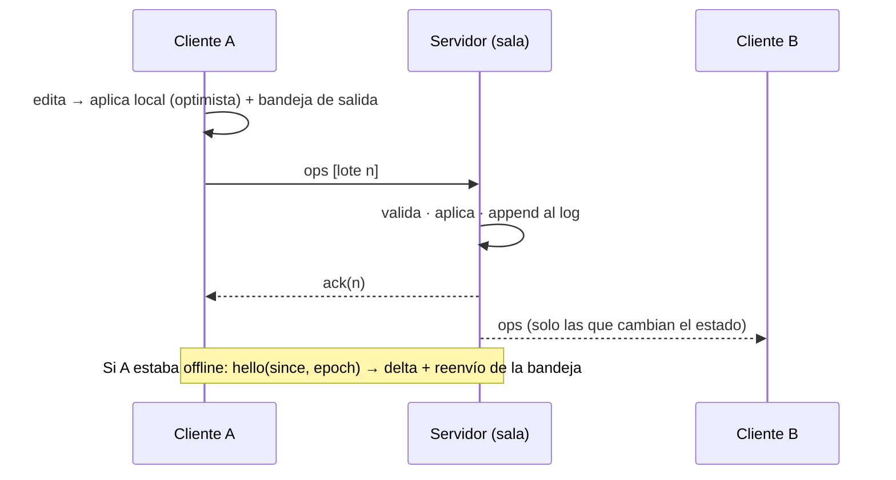

# ▦ Collab Board — tablero kanban colaborativo en tiempo real

Un tablero donde varias personas editan a la vez, **sin bloqueos, sin "último que guarda gana" a nivel de documento y con soporte offline real**. El motor de sincronización es un **CRDT implementado desde cero** (relojes lógicos híbridos, registros LWW por campo e índices fraccionarios), no una librería.

| | |
|---|---|
| **Núcleo compartido** | `@collab/core`: CRDT, protocolo con validación y cliente de sync. Sin dependencias del DOM: corre igual en navegador y en Node |
| **Servidor** | Node 22 · TypeScript estricto · `ws` · log de operaciones append-only en disco (JSONL) |
| **Cliente** | React 19 · Vite · `useSyncExternalStore` · drag & drop nativo |
| **Calidad** | **42 tests**: propiedades de convergencia con entrega aleatoria + integración sobre WebSockets reales |

## Arranque rápido

```bash
npm install
npm run dev:server   # ws + HTTP en :4100  (datos en ./data)
npm run dev:web      # http://localhost:5174
npm test             # 25 (core) + 17 (servidor)
```

1. Crea un tablero y copia el enlace con **Share**.
2. Ábrelo en otra pestaña (o en otro navegador): verás los avatares, quién mira/edita cada tarjeta, y los cambios en vivo.
3. Pulsa **Go offline** en una pestaña, edita en ambas y vuelve a **Go online**: todo se fusiona.

Con Docker: `docker compose up --build` → http://localhost:8081.

## Cómo funciona



### El CRDT (`packages/core/src/board.ts`)
El estado es un mapa de entidades (tarjetas, columnas) cuyos campos son **registros LWW**: `{valor, timestamp}`. Aplicar una operación es `si op.ts > registro.ts → sobrescribir`. Eso hace la fusión:

- **Conmutativa**: el orden de llegada no importa.
- **Idempotente**: reenviar o duplicar es inofensivo (por eso el cliente puede reintentar sin miedo).
- **Asociativa**: se puede fusionar por lotes o con snapshots.

Resultado: **convergencia eventual sin coordinación**. Dos ediciones de campos distintos de la misma tarjeta (título vs. descripción) se conservan ambas; solo el *mismo campo* concurrente se resuelve por LWW.

### Relojes: HLC (`hlc.ts`)
Un timestamp `wall-counter-node` en base36 con relleno fijo, comparable como string.
- Respeta causalidad aunque los relojes de los dispositivos estén desfasados (los tests simulan ±30 s).
- El `node` desempata: el orden es total, requisito de LWW.
- Se rechazan timestamps a más de 1 h en el futuro (un cliente malicioso podría "envenenar" el reloj y ganar todos los conflictos para siempre).

### Orden: índices fraccionarios (`fractional.ts`)
Mover una tarjeta entre otras dos genera **una sola clave** entre sus vecinas (`between("V","k") → "b"`), sin renumerar el resto. Un reordenamiento es 1 operación, no N. Optimizado para los extremos (añadir al final/principio crece 1 carácter cada ~32 inserciones).

### Movimiento atómico
Columna y posición viajan en **un único registro** `place = "col:pos"`. Si dos personas mueven la misma tarjeta a la vez, gana *un* movimiento completo; nunca se mezcla la columna de uno con la posición del otro. *(Esto fue un bug de la primera versión, con `col` y `pos` separados.)*

### Offline-first (`client.ts`)
- Las ediciones se aplican al instante y pasan a una **bandeja de salida persistente** (localStorage).
- Reconexión con backoff exponencial + jitter; detección de conexión muerta con heartbeat.
- `hello(since, epoch)` → el servidor envía solo el delta. Si el `epoch` cambió (compactación o servidor reiniciado sin datos), el cliente **reafirma todo su estado local**; al ser idempotente, es seguro.
- Recargar la página offline conserva el trabajo pendiente.

### Servidor
- **Una sala por tablero**, con cola serializada de escrituras: el orden en disco = el orden de difusión.
- **Solo se registran y difunden las operaciones que cambian el estado**: el log se mantiene limpio y los reenvíos no lo inflan.
- **Compactación**: cuando el log supera `2×snapshot + 500`, se reescribe como snapshot mínimo (una op por registro) con **escritura atómica** (`tmp` + `rename`) y un `epoch` nuevo. 80 ediciones de un título quedan en 1 línea.
- Carga tolerante a una **última línea truncada** (caída durante un append).
- Si falla la escritura en disco, la sala se descarta y los clientes reconectan y releen del disco (memoria y disco nunca divergen en silencio).

## Decisiones y trade-offs

| Decisión | Por qué | Coste / alternativa |
|---|---|---|
| CRDT propio de registros LWW en vez de Yjs/Automerge | Demuestra entender el problema; el dominio (tarjetas) no necesita texto colaborativo carácter a carácter | Para co-editar el *texto* de una descripción haría falta un CRDT de secuencias (RGA/Yjs). Hoy: LWW por campo |
| Servidor relay con log, no P2P | Persistencia, validación y control de acceso centralizados | El servidor es un punto único; escalar horizontalmente requeriría sharding por tablero (hash del id) o un bus pub/sub |
| Log JSONL en disco | Simple, inspeccionable, recuperable | Para producción real: Postgres/SQLite con tabla de ops, o object storage + snapshots |
| Tombstones (`del=true`) sin purga | Necesarios para que un borrado concurrente no "resucite" | Crecen sin límite; se purgarían con un protocolo de estabilidad causal (todos los clientes confirmaron) |
| "Capability URL" (id aleatorio de 192 bits) | Cero fricción para compartir | Quien tiene el enlace tiene acceso total; no hay roles. El siguiente paso serían enlaces de solo lectura |
| `clientId` **por pestaña** | Dos pestañas con el mismo `node` HLC podrían emitir timestamps idénticos y el LWW descartaría una op en silencio | Cada pestaña nueva hace un sync completo |

## Seguridad y robustez (todo con test)

- Validación **estricta con Zod** de cada mensaje y operación: tipo de valor por campo, longitudes, formato de ids y claves → un cliente no puede inyectar estructuras raras ni ids tipo `../../etc/passwd`.
- Límites: 500 ops por mensaje, 256 KB por frame, 5 000 tarjetas y 50 columnas por tablero, 50 personas por sala.
- **Rate limit** por conexión (cubo de tokens): quien inunda es desconectado (1008).
- Comprobación de **Origin** en el upgrade de WebSocket y en CORS.
- Un lote de ops inválido se rechaza **sin tumbar la conexión** y el cliente lo descarta (no bloquea su cola).
- Ids de tablero validados antes de tocar el sistema de ficheros.

## Pruebas

- `packages/core/test`: reloj (retroceso, desfase, envenenamiento), índices fraccionarios (2 000 inserciones aleatorias en orden), LWW, **convergencia bajo caos**: 8 semillas × 4 réplicas × 120 operaciones aleatorias con relojes desfasados, sincronizaciones parciales, **entrega desordenada y con duplicados** → todas las réplicas terminan idénticas.
- `apps/server/test`: dos clientes reales sobre WebSocket, offline/reconexión, recarga con estado pendiente, reinicio del servidor, línea truncada, compactación con cambio de epoch, pérdida de datos del servidor, origen no permitido, flood, timestamps futuros, límites de tamaño.

## Estructura

```
packages/core/src   hlc · fractional · board (CRDT) · doc (comandos) · protocol (Zod) · client (sync offline-first)
apps/server/src     server (HTTP+WS) · room (sala, cola, compactación) · oplog (memoria / JSONL)
apps/web/src        Home · BoardPage (DnD + presencia) · useBoard (store React)
```

## Qué haría después

- CRDT de secuencias para el texto de las descripciones (co-edición carácter a carácter).
- Roles y enlaces de solo lectura; autenticación opcional.
- Purga de tombstones con estabilidad causal.
- Escalado horizontal: sharding por `boardId` y pub/sub entre nodos.
- Historial / deshacer por usuario aprovechando el log de operaciones.
