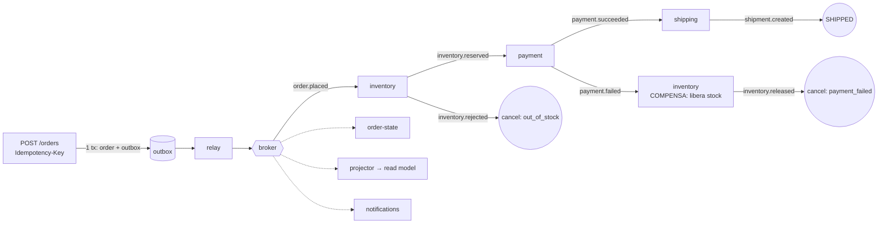

# ▤ Orderflow — pipeline de pedidos orientado a eventos

Un sistema de procesamiento de pedidos **asíncrono, tolerante a fallos y consistente a la larga**, con el broker de mensajes construido desde cero sobre PostgreSQL. Demuestra los patrones que separan un backend "que funciona" de uno que **sigue funcionando cuando todo falla**.

| Patrón | Dónde |
|---|---|
| **Transactional outbox** + relay | `broker/outbox.ts` |
| Pub/sub con **grupos de consumidores**, leases y **orden FIFO por clave** | `broker/broker.ts` |
| **Reintentos** con backoff exponencial + jitter, **DLQ** y replay | `broker/types.ts`, `broker/broker.ts` |
| **Consumidores idempotentes** (bandeja de entrada) y *fencing* | `broker/worker.ts` |
| **Saga coreografiada** con **compensación** | `services/consumers.ts` |
| **Idempotency-Key** en la API | `services/orders.ts` |
| **CQRS** con modelo de lectura eventualmente consistente | `order_view`, `projector` |
| Observabilidad: métricas Prometheus, lag por consumidor, dashboard | `api/`, `/metrics` |

**Stack:** Node 22 · TypeScript estricto · Fastify · PostgreSQL (`pg`; PGlite en dev/tests) · Zod. **41 tests** (+1 contra Postgres real en CI).

## Arranque rápido (sin Docker ni infraestructura)

```bash
npm install
npm run dev      # http://localhost:4200  → dashboard (Postgres embebido con PGlite)
npm test
```

En el dashboard: haz pedidos, activa **"Deploy a bug in inventory"**, haz más pedidos y mira cómo se agotan los reintentos y caen en la **DLQ**. Desactiva el bug y pulsa **Replay**: los pedidos atascados se completan sin perder datos. Prueba también **Double-submit** (misma Idempotency-Key → un solo pedido) y la caída de la pasarela de pago.

Con Postgres real y roles separados: `docker compose up --build --scale worker=3` (API y workers como procesos distintos que compiten por el trabajo).

## La saga



Cada servicio reacciona a eventos y emite los suyos (**coreografía**, sin orquestador central). Si el pago es rechazado definitivamente, `payment.failed` dispara la **compensación**: inventario devuelve el stock reservado. Los errores *transitorios* (timeout de la pasarela) no compensan: se reintentan.

## Cómo se consigue cada garantía

### Nunca hay un cambio sin evento (ni un evento sin cambio) — *outbox*
El dual-write "guardar en BD y publicar en el broker" puede quedar a medias. Aquí el evento se inserta en la **misma transacción** que el cambio; un *relay* lo lleva al broker después. El relay es **at-least-once**: si muere entre publicar y marcar, republica, y el broker descarta el duplicado por `message_id`. *(Test: `a relay crash between publish and mark causes a re-publish, never a duplicate delivery`.)*

### Cada mensaje tiene efecto exactamente una vez — *consumidor idempotente*
La entrega es at-least-once (reintentos, leases vencidos, relays redundantes), así que la idempotencia vive en el consumidor. En **una sola transacción**: se inserta en `processed_messages` (si ya existía → duplicado, se omite), se ejecuta el handler, se escriben los eventos de salida y se marca la entrega como hecha. Todo se confirma o todo se revierte. *(Test: tormenta de redeliveries sin ningún efecto duplicado: stock, cobros, envíos, emails.)*

### Un worker lento no corrompe nada — *lease + fencing*
`claim` usa `FOR UPDATE SKIP LOCKED` y asigna un **lease**. Si el worker muere, el lease vence y otro retoma la entrega; **ese intento cuenta**, así que un mensaje venenoso que mata al worker acaba en la DLQ en vez de reiniciarse eternamente. Si un worker lento sigue vivo tras perder el lease, su `UPDATE … WHERE locked_by = yo` falla y **toda su transacción se revierte** (fencing).

### El orden se respeta donde importa — *FIFO por clave*
Un mensaje solo es reclamable si no hay otro anterior **de la misma clave** (`orderId`) sin terminar. Los eventos de un pedido se procesan en orden; pedidos distintos van en paralelo. Una máquina de estados **monótona** (`nextStatus`) protege además contra eventos atrasados o repetidos.

### Los fallos no se pierden ni se reintentan a ciegas — *backoff + DLQ*
`delay = ½·exp + rand·½·exp` (equal jitter, tope de 60 s): el jitter evita la estampida de reintentos; la mitad fija evita el retardo 0. Tras 5 intentos —o de inmediato con un `PermanentError`— la entrega pasa a la DLQ con su último error. Se inspecciona y se **reencola** con un clic cuando el bug o el sistema externo se arreglan.

### Pagar dos veces es imposible — *idempotencia de extremo a extremo*
La API acepta una `Idempotency-Key` (PK única, respuesta guardada: misma clave ⇒ mismo pedido, `200` + `Idempotent-Replayed`; misma clave con otro cuerpo ⇒ `422`). La pasarela se llama con el `orderId` como clave de idempotencia, como Stripe/Adyen, así que reintentar tras un timeout ambiguo no cobra dos veces. *(Test de caos: un cobro por pedido enviado, ni uno más.)*

### Consistencia eventual, visible y medible — *CQRS*
`GET /orders/:id` lee el modelo de escritura (inmediato). `GET /orders` y el *timeline* leen el modelo de lectura que construye el `projector`, que va unos instantes por detrás. Esto se prueba explícitamente. El **lag** (`broker_queue_oldest_ready_age_seconds`) se expone por consumidor.

## Decisiones y trade-offs

| Decisión | Por qué | Coste / cuándo cambiar |
|---|---|---|
| Broker sobre **Postgres** (SKIP LOCKED) | Sin infraestructura extra; transaccional con el outbox; trivial de operar e inspeccionar con SQL | Techo de throughput (~miles msg/s) y *polling*. Para mayor escala: Kafka/SQS detrás de la misma interfaz `Broker` |
| **Coreografía** en vez de orquestación | Servicios desacoplados, sin punto central | El flujo está repartido: para sagas largas o con muchas ramas, un orquestador (Temporal) es más legible |
| Una DLQ **no bloquea** su clave | Disponibilidad: un mensaje venenoso no paraliza el pedido para siempre | Puede romper el orden estricto tras un replay; por eso la máquina de estados es monótona |
| Llamada externa **dentro** de la transacción del handler | Simple y atómica con los efectos | Mantiene una conexión abierta durante la llamada; con latencias altas conviene el patrón "intención + worker de envío" |
| Sin *exactly-once delivery* | Es inalcanzable en general | Lo que se garantiza es **efecto** exactly-once = at-least-once + idempotencia |
| Suscripciones fijadas **antes** de publicar | El fan-out se calcula al publicar | Un consumidor nuevo no ve el histórico (haría falta *replay* desde `messages`) |
| Dashboard sin build (HTML + JS vanilla) | Cero dependencias de frontend | No es un producto de UI; es una consola de operación |

## Pruebas

- **Broker** (18): fan-out, publicación duplicada, leases y recuperación tras caída, FIFO por clave, backoff, DLQ y replay, *fencing*, métricas, atomicidad del handler (si falla, se revierten efectos **y** eventos), relay con caída simulada, dos relays en carrera.
- **Saga** (11): camino feliz, sin stock, tarjeta rechazada con compensación, fallos transitorios con un único cobro, bug en producción → DLQ → arreglo → replay, proveedor de email caído sin afectar al pedido, **sin sobreventa** (12 pedidos / 5 unidades), tormenta de redeliveries, eventos atrasados, orden por pedido y una **ejecución de caos** con fallos alternos que termina con estados terminales, cola vacía, stock conservado y un cobro por envío.
- **API** (12): idempotency keys (incluido doble envío simultáneo), validación, consistencia eventual, DLQ/replay por HTTP, caos, métricas, token de admin y una **regresión** encontrada probando en el navegador.
- Todos los tests usan un **reloj falso**: el backoff y los leases se prueban sin dormir.
- `TEST_DATABASE_URL` ejecuta además la prueba de **workers concurrentes** sobre Postgres real (job `test-postgres` en CI). PGlite tiene una sola conexión, así que esa prueba no corre en local.

## Operación

| Qué | Cómo |
|---|---|
| Colas, lag, DLQ | Dashboard `/`, `GET /api/admin/queues`, `GET /metrics` |
| Reencolar | `POST /api/admin/dlq/:id/replay`, `POST /api/admin/dlq/replay-all?consumer=…` |
| Seguridad | `ADMIN_TOKEN` protege `/api/admin/*` (comparación en tiempo constante) |
| Apagado | `SIGTERM` deja de reclamar y espera a las entregas en curso |
| Roles | `ROLE=api` (acepta pedidos) · `ROLE=worker` (relay + consumidores) · `ROLE=all` (dev) |

## Estructura

```
src/broker/    broker (publish/claim/fail/DLQ) · worker (inbox + fencing) · outbox (relay) · types (retry) · metrics
src/services/  events (máquina de estados) · consumers (la saga) · gateway (pagos/email simulados + caos) · orders (idempotencia)
src/api/       app (Fastify) · dashboard
src/system.ts  ensamblado, drain() determinista para tests
test/          broker · saga · api
```

## Qué haría después

- Particionar el polling con `LISTEN/NOTIFY` para latencia sub-100 ms sin cargar la BD.
- Purga/archivado de `messages`, `deliveries` y `processed_messages` (retención por antigüedad).
- Trazas distribuidas (propagar `traceparent` en los eventos) y alertas sobre lag y DLQ.
- Un orquestador explícito para una saga larga (reembolsos, devoluciones) y comparación con la coreografía.
- Reproducción histórica para consumidores nuevos.
