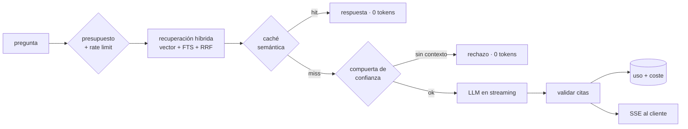

# ✦ Docs Assistant — RAG de producción con evaluación continua

Un asistente que responde preguntas sobre documentos **citando sus fuentes**, en streaming, y que **sabe decir "no lo sé"**. No es un wrapper de chat: el foco está en lo que hace que una app de IA sea fiable y asumible en producción — recuperación híbrida, defensas, control de costes y, sobre todo, **un arnés de evaluación que bloquea las regresiones en CI**.

| | |
|---|---|
| **Búsqueda** | PostgreSQL + **pgvector** (HNSW, coseno) + texto completo (`tsvector`), fusionados con **Reciprocal Rank Fusion** |
| **Generación** | Claude (Messages API con **streaming SSE**, sin SDK) · embeddings Voyage · o stack local sin claves |
| **Fiabilidad** | Reintentos con backoff + `Retry-After`, **cortacircuitos**, timeouts, cancelación al desconectarse el cliente |
| **Costes** | Tokens y USD por llamada, **presupuesto diario por cliente**, rate limit, **caché semántica**, rechazo sin gastar tokens |
| **Calidad** | Dataset dorado de 44 preguntas, métricas de recuperación y generación, **puerta de calidad** (`npm run eval:gate`) |
| **Tests** | **66 tests** (SSE con `fetch` simulado, inyección de prompts, conexión HTTP real, cancelación…) |

## Arranque rápido (sin claves, sin red, sin Docker)

```bash
npm install
npm run dev          # http://localhost:4300  → UI de chat con el corpus de ejemplo ya indexado
npm test             # 66 tests
npm run eval         # informe de calidad + comparación de modos de búsqueda
npm run eval:gate    # lo mismo, y falla (exit 1) si hay regresión
```

Por defecto usa un **stack local determinista** (embeddings hash + LLM extractivo + PGlite con pgvector) para que todo —incluida la evaluación— se ejecute sin dependencias externas. Para modelos reales:

```bash
LLM_PROVIDER=anthropic ANTHROPIC_API_KEY=sk-ant-... \
EMBED_PROVIDER=voyage  VOYAGE_API_KEY=pa-... \
PRICE_INPUT_PER_MTOK=<tarifa> PRICE_OUTPUT_PER_MTOK=<tarifa> npm run dev
```

> **Honestidad sobre el stack local:** el embedder hash captura solapamiento léxico (palabras, bigramas, trigramas), **no semántica**; el LLM local *selecciona* frases, no genera. Es un sustituto para desarrollar y evaluar el pipeline, no un modelo. Los números de abajo son los de ese stack. **El cliente de Anthropic y el de Voyage están probados con respuestas simuladas, no contra las APIs reales** (no había claves en el entorno de desarrollo).

## Pipeline de una pregunta



## Resultados medidos (44 preguntas: 38 respondibles, 6 sin respuesta)

**Por qué híbrida** — recuperación sobre las preguntas respondibles:

| Modo | hit@1 | hit@3 | hit@5 | MRR | hit@5 (paráfrasis) |
|---|---|---|---|---|---|
| Léxica (tsvector) | 92,1 % | 100 % | 100 % | 0,961 | 100 % |
| Vectorial (pgvector) | 92,1 % | 97,4 % | 97,4 % | 0,947 | 90 % |
| **Híbrida (RRF)** | **97,4 %** | **100 %** | **100 %** | **0,987** | **100 %** |

Cada método falla en cosas distintas, y la fusión las corrige. Un test (`hybrid retrieval is at least as good as either single method`) lo protege.

**Pipeline completo** (stack local):

| Métrica | Valor |
|---|---|
| Respuestas correctas (todos los hechos esperados, sin rechazar) | 86,8 % |
| Fundamentadas (citas válidas o rechazo explícito) | 100 % |
| Precisión de citas (la fuente citada es la esperada) | 100 % |
| Preguntas sin respuesta correctamente rechazadas | 83,3 % |
| Respondibles rechazadas por error | 5,3 % |
| Latencia p50 / p95 | ~120 ms / ~260 ms |

Los fallos restantes son casi todos del LLM local extractivo con paráfrasis ("vacation" vs. "paid time off"): justo donde un modelo real aporta. `npm run eval -- --verbose` lista cada caso fallido.

### Decisiones guiadas por la evaluación (lo importante)

1. **Una "mejora" que empeoraba el sistema.** Permití que el LLM local respondiera con un solo término raro en común: las respuestas correctas subieron (84 → 87 %) pero los rechazos correctos **cayeron de 83 % a 67 %**. Responder mal es peor que rechazar, así que **lo revertí**. Sin el arnés, habría parecido una mejora.
2. **Calibración de la compuerta de confianza.** El barrido de umbrales (`npm run eval`) muestra que con embeddings débiles las paráfrasis respondibles y las preguntas ajenas se solapan. Elegí el punto que atrapa 3/6 preguntas ajenas **sin perder ninguna respondible** (0/38) y dejé el rechazo final al LLM. Un test unitario con texto basura destapó que el umbral inicial (0,12) dejaba pasar ruido; subió a 0,25.
3. **Cobertura ponderada por IDF.** "Northwind" aparece en todos los documentos (no informa); "student" o "Madrid" no aparecen en ninguno (delatan una pregunta ajena). Pesar los términos por rareza lo distingue.
4. **La puerta de calidad es real:** con umbrales de confianza mal calibrados (un cambio plausible), `eval:gate` sale con código 1 (`correctRate 0.211 < 0.82`) y con la configuración buena pasa.

## Cómo está construido

### Recuperación (`rag/retrieve.ts`)
- **Vectorial** (pgvector, HNSW, coseno): entiende paráfrasis, falla con códigos y cifras exactas.
- **Léxica** (`tsvector` + `ts_rank_cd`, consulta OR con prefijos sobre términos con stem): exacta con términos raros, ciega a sinónimos. La consulta se construye sin pasar operadores del usuario (test de inyección de tsquery).
- **RRF**: suma `1/(60+rank)`; no hace falta normalizar puntuaciones de escalas incomparables. Tope de chunks por documento para que uno no monopolice el contexto.

### Ingesta (`rag/ingest.ts`, `rag/chunker.ts`)
- Chunking **consciente de la estructura**: respeta encabezados (la ruta `Doc > Sección` se guarda y se antepone al embedding), no parte frases, añade solape por frases, ignora `#` dentro de bloques de código.
- **Idempotente por hash**: contenido sin cambios ⇒ cero llamadas de embeddings. Reemplazo atómico en una transacción. Embeddings calculados **antes** de abrir la transacción (no se retiene una conexión durante llamadas de red).
- Cambiar de modelo de embeddings con un índice existente **falla con un mensaje claro** (hay que reindexar), en vez de mezclar espacios vectoriales.

### Seguridad frente a inyección de prompts (`rag/prompt.ts`)
Los documentos son **datos no confiables**: se escapan `<`, `>` y `&` (un documento no puede cerrar `</document>` ni abrir `<question>`), el prompt de sistema los declara datos, y se valida la salida (citas inexistentes ⇒ `grounded:false`). Hay un test de extremo a extremo con un documento envenenado. *Ninguna defensa de prompts es absoluta: esto reduce la superficie, no la elimina; por eso además el modelo no tiene herramientas ni acciones.*

### Streaming y cancelación (`api/app.ts`, `providers/anthropic.ts`)
SSE (`sources → token… → done`) con parser propio, probado con trozos de 7 bytes. Si el usuario cierra la pestaña se **aborta la llamada al modelo** y se factura solo lo generado. *Un bug real encontrado con tests:* `req.on('close')` se emite al terminar de leer el cuerpo, no al cerrar la conexión; la señal correcta es el cierre de la **respuesta** sin haber terminado de escribirla (test con servidor HTTP real).

### Fiabilidad del proveedor (`providers/resilience.ts`)
Reintenta solo errores transitorios (429, 5xx, red) con backoff exponencial + jitter y respeta `Retry-After`; **no** reintenta 4xx. Una vez que llegan tokens ya no se reintenta (duplicaría texto y coste). El **cortacircuitos** falla rápido tras N errores y prueba con una sola petición al enfriarse.

### Costes (`cost.ts`, `rag/cache.ts`)
- `usage_log` registra tokens, USD, latencia y resultado (`ok`, `refused`, `cache_hit`, `error`, `aborted`) de cada llamada.
- **Presupuesto diario por cliente** calculado desde la base de datos (compartido entre instancias) y **rate limit** de ventana deslizante, con `429` y `Retry-After` *antes* de abrir el stream.
- **Caché semántica**: preguntas casi idénticas reutilizan la respuesta (0 tokens, ~10 ms). Solo se cachean respuestas fundamentadas; se **invalida sola** al cambiar el corpus; caduca por TTL; no se usa con historial de conversación.
- **Rechazo sin llamar al modelo** cuando la recuperación no encuentra nada relevante.
- Los precios **no están inventados**: `PRICE_*_PER_MTOK` se configura con la tarifa vigente (por defecto 0).

## Decisiones y trade-offs

| Decisión | Por qué | Coste / alternativa |
|---|---|---|
| pgvector en Postgres, no una BD vectorial aparte | Una sola base: transacciones, FTS, backups; HNSW rinde de sobra a esta escala | Con cientos de millones de vectores, Qdrant/Milvus/pgvectorscale |
| Híbrida + RRF, sin *reranker* | Mejor relación calidad/coste/latencia; medida, no supuesta | Un cross-encoder sobre los ~20 candidatos subiría la precisión (siguiente paso) |
| Cliente HTTP propio en vez del SDK | Streaming y reintentos controlables, cero dependencias, fácil de simular | Hay que mantener el parser SSE; el SDK sería razonable en un equipo grande |
| Evaluación con *oracle* de hechos (no LLM-juez) | Determinista, gratis, reproducible en CI | Mide "¿aparecen los hechos?", no el estilo; un LLM-juez complementaría con muestras |
| Rate limit en memoria | Simple | Con varias instancias, Redis |
| Sin autenticación de usuarios (cliente = cabecera/IP) | El alcance es la capa de IA | En producción: identidad real para presupuesto y límites |

## Pruebas

- **Chunker y proveedores** (23): estructura de encabezados, solape, bloques de código, SSE en trozos arbitrarios, reintentos con `Retry-After`, 4xx sin reintento, error en el stream, cancelación, lotes y orden de Voyage, cortacircuitos (abre, falla rápido, semiabre, se cierra).
- **Pipeline RAG** (27): ingesta idempotente y reemplazo atómico, modos de recuperación, tsquery seguro, **inyección por delimitadores**, citas inventadas/ausentes, rechazo sin llamar al modelo, caché (hit, invalidación por ingesta, no cachea lo infundado), presupuesto por cliente, facturación al abortar, errores del proveedor.
- **API y evaluación** (16): SSE en orden, límites de entrada, rate limit con `Retry-After`, presupuesto agotado antes del stream, error amigable sin trazas, admin token, **la puerta de calidad sobre el corpus real**, y **desconexión sobre HTTP real**.

## Operación

| Qué | Cómo |
|---|---|
| Subir documentos | UI (pegar o arrastrar `.md`/`.txt`) o `POST /api/documents` (token de admin) |
| Uso y coste | `GET /api/usage`: peticiones, cache hits, rechazos, tokens, USD, p50/p95 |
| Calidad | `npm run eval` (+ `--verbose`), `eval/golden.json`, `eval/thresholds.json` |
| Cambiar de modelo de embeddings | Reindexar (la app lo exige con un error explícito) y **recalibrar** umbrales con el barrido del eval |

## Qué haría después

- **Reranker** (cross-encoder) sobre los candidatos y *contextual retrieval* (resumen del documento antepuesto a cada chunk).
- Evaluación con **LLM-juez** muestreada (fidelidad, relevancia) y *tracing* de cada paso para depurar fallos reales de producción.
- Evaluación **online**: pulgar arriba/abajo en la UI alimentando el dataset dorado.
- Citas a nivel de frase y resaltado del fragmento exacto.
- Re-ingesta incremental por chunk y control de acceso por documento (filtrar *antes* de recuperar).
