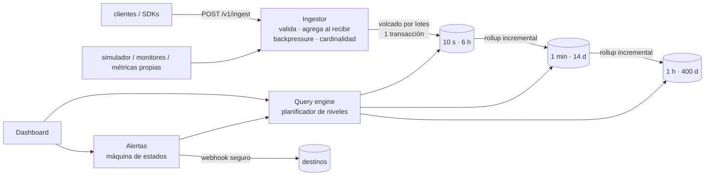

# ◉ Pulse — plataforma de observabilidad

Ingiere métricas a alto volumen, las guarda como **series temporales con rollups y retención por niveles**, responde consultas con **percentiles correctos** (p50/p99 agregables), evalúa **alertas con máquina de estados**, ejecuta **monitores de uptime** y se **monitoriza a sí misma** con su propio pipeline. Todo con un dashboard de gráficos dibujados a mano sobre `<canvas>`.

| | |
|---|---|
| **Stack** | Node 22 · TypeScript estricto · Fastify · SQLite (`node:sqlite`, WAL) · Zod · undici |
| **Ingesta** | ~115 k puntos/s en proceso · ~86 k puntos/s por HTTP *(medido, ver abajo)* · compresión 48:1 |
| **Percentiles** | DDSketch propio: error relativo ≤ 1 %, **mergeable** entre series, cubetas y niveles |
| **Seguridad** | Anti-SSRF a nivel de conexión, límites de cardinalidad, validación estricta, API key |
| **Tests** | **84 tests** (precisión estadística, rollups con datos tardíos, alertas, SSRF, API) |

## Arranque rápido (sin Docker, sin servicios externos)

```bash
npm install
npm run dev        # http://localhost:4400 — con tráfico simulado, 60 min de historial y 3 reglas de alerta
npm test           # 84 tests
npm run bench      # benchmark reproducible
```

En el dashboard pulsa **Trigger incident**: en ~30 s verás cómo las alertas pasan de `pending` a `firing`, aparece el banner y, al resolver el incidente, vuelven a `resolved`. Añade un **monitor de uptime** con cualquier URL pública.

Enviar tus propias métricas:

```bash
curl -X POST localhost:4400/v1/ingest -H 'content-type: application/json' -d '{
  "points": [
    {"name":"http_requests_total","type":"counter","labels":{"service":"api"},"value":42},
    {"name":"http_request_duration_ms","type":"timer","labels":{"service":"api"},"value":183.5},
    {"name":"cpu_usage_percent","type":"gauge","labels":{"host":"web-1"},"value":61.2}
  ]}'

curl 'localhost:4400/v1/query?metric=http_request_duration_ms&agg=p99&range=3600&groupBy=service'
```

## Arquitectura



### Modelo de datos: la *celda*
Todo el sistema gira alrededor de una `Cell`: `{count, sum, min, max, last, sketch?}` de una serie en una cubeta de tiempo. La ingesta la construye, el almacén la guarda, y los rollups y las consultas la **fusionan**. `merge` es asociativo y conmutativo (un monoide), así que se puede agregar en cualquier orden y por tramos. Un test lo comprueba.

### Tres tipos de métrica
`counter` (incrementos; `sum`, `rate`), `gauge` (`avg`, `min`, `max`, `last`) y `timer` (todo lo anterior **+ percentiles**). El tipo es fijo por métrica: mezclarlo se rechaza.

## Decisiones técnicas

### 1. Percentiles que no mienten (`sketch.ts`)
El p99 de dos series **no** es la media de sus p99. Si se guardara solo el p99 por minuto, cualquier rollup o agregación entre instancias daría un número incorrecto. Pulse guarda un **DDSketch** (histograma de cubetas logarítmicas con error relativo acotado al 1 %) por cubeta de tiempo y los **fusiona**. Tests: error ≤ 1,1 % sobre 50 000 latencias lognormales (cola larga); `merge(a, b)` da exactamente lo mismo que el sketch de la unión; el cálculo ingenuo (media de p99) falla por más de un 5 %; y el p99 se mantiene correcto tras **dos niveles de rollup**.

### 2. Agregar al recibir, no guardar puntos crudos
Un punto = una fila sería inviable. Se acumula una celda por `(serie, cubeta de 10 s)` en memoria y se vuelca por lotes en **una transacción** (upsert en SQL para lo numérico; los sketches se leen-fusionan-escriben). En el benchmark, **1 000 000 de puntos → 21 000 filas (48:1)**.

### 3. Backpressure y *load shedding*
La memoria está acotada (`MAX_PENDING_KEYS`). Si el volcado no da abasto, la API responde **`429` + `Retry-After`** en lugar de crecer hasta caerse; al vaciarse vuelve a aceptar. Un volcado fallido **devuelve el lote a la cola** y lo fusiona con lo que llegó mientras tanto (test: no se pierde ni se duplica nada). El apagado ordenado vuelca lo pendiente.

### 4. Cardinalidad: lo que de verdad mata a un sistema de métricas
Una etiqueta como `user_id` crea una serie por valor. Hay tope **por métrica** y **global**; al superarlo se rechazan las series *nuevas* (las existentes siguen funcionando) y se contabiliza. Probado en vivo: 3 000 `user_id` distintos ⇒ 2 000 aceptadas, 1 000 rechazadas con motivo, el servidor intacto.

### 5. Retención por niveles + rollups recalculados
| Nivel | Resolución | Retención |
|---|---|---|
| 10 s | detalle | 6 h |
| 1 min | medio | 14 d |
| 1 h | grueso | 400 d |

- El **planificador** elige el nivel más fino que todavía conserva los datos y cuya resolución cabe en el paso pedido: una consulta de 1 h usa 10 s, de 3 días usa 1 min, de 6 meses usa 1 h. El coste depende de los puntos *pedidos*, no del volumen ingerido.
- Los rollups se **recalculan desde el nivel inferior** para las cubetas "sucias" en vez de sumar deltas: es **idempotente** y los **datos tardíos corrigen** los agregados.
- **Lectura fresca:** si hay cubetas sucias en el rango, se refrescan antes de leer (*read-your-writes*).
- Si el nivel inferior ya expiró, **no se recalcula** (recalcular desde una fuente vacía borraría datos buenos; hay test).

### 6. Alertas sin tormentas (`alerts.ts`)
```
ok ──cond──▶ pending ──cond durante forSec──▶ firing ──!cond──▶ ok (resolved)
                └──!cond──▶ ok  (un pico corto no notifica a nadie)
```
Estado **por grupo** (un servicio caído no dispara los demás), notificación **solo en transiciones** (más `repeatSec` opcional), `noData: 'alert'` para un **dead man's switch** (el silencio *es* la alerta), y estado **persistido**: tras un reinicio no se pierde ni se re-notifica una alerta ya disparada.

### 7. Webhooks y monitores seguros (`net.ts`)
Un usuario puede configurar una URL; no debe poder apuntar a la red interna. Defensa **en el momento de conectar** (dentro del `lookup` del socket), no antes: validar el DNS y dejar que el cliente lo resuelva otra vez permite *DNS rebinding*. IP literales validadas previamente; **sin seguir redirecciones**; rango completo de IPs privadas/link-local/metadatos de cloud (`169.254.169.254`), IPv6 e IPv4 mapeada. Reintentos con backoff, pero **nunca** sobre un destino bloqueado. Todo con tests, incluido un rebinding simulado.

### 8. Dogfooding
Los monitores de uptime escriben `uptime_check_success` y `uptime_check_duration_ms` como métricas normales, y Pulse emite sus propias métricas de salud (`pulse_points_rejected_total`, `pulse_pending_keys`…) por el mismo pipeline: se consultan, grafican y alertan igual que cualquier otra.

## Rendimiento medido (`npm run bench`)

Datos sintéticos, **esta máquina** (un portátil Windows). Úsalo para *comparar cambios*, no como promesa.

| Prueba | Resultado |
|---|---|
| Ingesta en proceso (1 M de puntos, 500 hosts × 7 rutas) | **~115 000 puntos/s** |
| Compresión por agregación al recibir | **48 : 1** (1 M de puntos → 21 000 filas) |
| Ingesta HTTP de extremo a extremo (JSON, 1 000 puntos/petición, 8 concurrentes) | **~86 000 puntos/s**, p50 59 ms, p99 193 ms por petición, 0 errores |
| Consulta `rate` agrupada (500 hosts × 7 rutas) | p50 **53 ms** |
| Consulta `p99` agrupada (fusión de sketches) | p50 **22 ms** |
| Consulta de una serie filtrada | p50 **0,4 ms** |

## Pruebas (84)

- **Estadística y núcleo** (20): precisión del sketch, mergeabilidad, monoide de celdas, validación y cardinalidad, planificador, backpressure, fallo de volcado sin pérdida, ventana deslizante.
- **Almacenamiento** (8): niveles coherentes entre sí, p99 correcto tras 2 rollups, **datos tardíos**, lectura fresca, retención, no borrar agregados cuando la fuente expiró, **persistencia tras reinicio** con SQLite en disco.
- **Alertas, red y monitores** (42): ciclo ok→pending→firing→resolved, picos que no disparan, grupos independientes, repetición, dead man's switch, **persistencia del estado**, 18 casos de IP privada, 8 URLs bloqueadas, **rebinding DNS**, redirecciones, reintentos del webhook, monitores contra servidores reales (200/500/timeout).
- **API** (14): ingesta parcial, 429 con `Retry-After`, API key, consultas con filtros, **SSRF vía reglas y monitores**, y un **escenario de incidente de extremo a extremo** (tráfico → p99 → alerta → resolución).

*Un test destapó un fallo de calibración del propio simulador:* el p99 normal de `checkout /pay` (~515 ms) superaba mi primer umbral de 400 ms, así que la alerta no se resolvía. Un umbral por debajo del comportamiento normal es justo el error clásico en alertas; lo subí a 800 ms.

## Qué NO es (límites conocidos)

- **Un solo nodo y un solo escritor.** `node:sqlite` es síncrono: mientras vuelca, bloquea el bucle de eventos unos milisegundos (visibles en `lastFlushMs`). Para escalar: mover el almacenamiento a un *worker thread* y, después, particionar por hash de serie.
- **`node:sqlite` es una API joven** (Node ≥ 22.13): puede mostrar un aviso de "experimental". Detrás de `Store` es sustituible por Postgres/TimescaleDB o ClickHouse sin tocar el resto.
- Sin compatibilidad con PromQL/Prometheus remote-write, sin logs ni trazas, sin multi-tenant, sin HA.
- **Docker y CI** están escritos pero **no se ejecutaron** (el servicio de Docker no estaba disponible); el bundle de producción sí arranca con `node dist/server.js`.
- El benchmark mide una máquina concreta; no es una garantía de capacidad.

## API

`POST /v1/ingest` · `GET /v1/query?metric=&agg=&range=|from=&to=&step=&groupBy=a,b&f.label=value` · `GET /v1/metrics` · `GET /v1/labels?metric=` · `GET|POST|DELETE /v1/rules` · `GET /v1/alerts` · `GET /v1/alerts/events` · `GET|POST|DELETE /v1/monitors` · `GET /v1/stats` · `GET /health`.
Agregaciones: `count sum avg min max last rate p50 p90 p95 p99 p99.9` (los percentiles solo en `timer`). Con `API_KEY` definida, `/v1/*` exige `Authorization: Bearer …`.

## Estructura

```
src/sketch.ts      DDSketch (percentiles mergeables)          src/alerts.ts    máquina de estados
src/cell.ts        monoide de agregación                      src/notifier.ts  webhooks con reintentos
src/series.ts      validación + registro + cardinalidad       src/net.ts       anti-SSRF (connect-time)
src/ingest.ts      agregación al recibir + backpressure       src/monitors.ts  uptime checks
src/store.ts       SQLite: niveles, rollups, retención        src/sim.ts       simulador de tráfico/incidentes
src/query.ts       planificador + agregaciones                src/api.ts · ui.ts · server.ts · bench.ts
```

## Qué haría después

- Almacenamiento en *worker thread* (o Postgres/ClickHouse) y particionado por serie para escalar la escritura.
- SDKs cliente (JS/Python) con *batching* y reintentos, y un endpoint compatible con el *remote write* de Prometheus.
- Alertas con comparación contra la semana anterior (estacionalidad) y silenciamientos/ventanas de mantenimiento.
- Logs y trazas (OpenTelemetry) correlacionados con las métricas por etiquetas.
